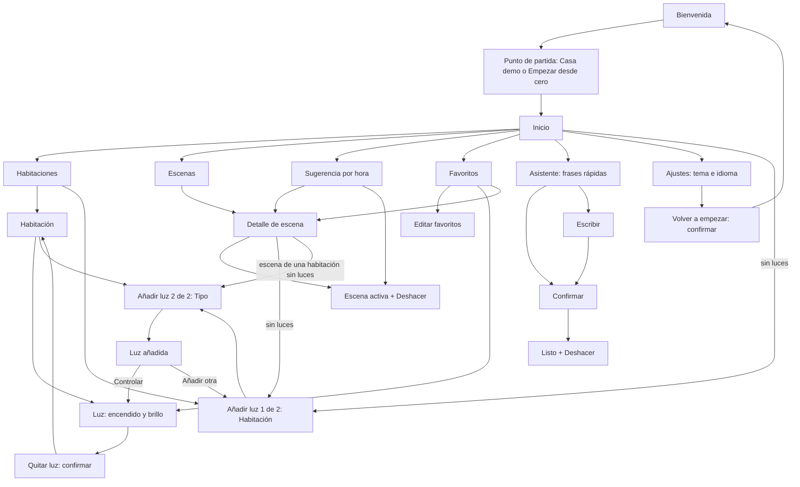
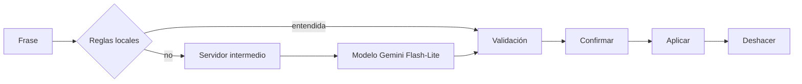
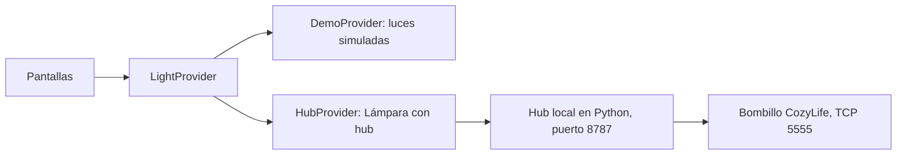

# LuminaWear — Documentación

App Wear OS para controlar las luces del hogar desde la muñeca. Proyecto individual de *Diseño de interfaces de software* (Universidad Cooperativa de Colombia, sede Pasto).

**Tecnología:** Kotlin, Compose para Wear OS, Wear Compose Material 3 · `minSdk 30` · tema claro por defecto y oscuro opcional · español e inglés con selector dentro de la app.

Más detalle en [`design-tokens.md`](design-tokens.md) (tokens), [`avances.md`](avances.md) (bitácora) y [`../hub/README.md`](../hub/README.md) (hub del bombillo).

---

## 1. Qué hace

- Trae una **casa demo de 8 luces** en 3 habitaciones (Sala, Dormitorio, Estudio) y permite **añadir y quitar luces** (hasta 6 por habitación, 3 habitaciones). Cada luz se enciende, se apaga y se ajusta de brillo.
- **Primer uso**: una bienvenida y, después, elegir entre «Casa demo» y «Empezar desde cero».
- **Escenas**: Descanso, Lectura, Concentración y Buenas noches, con sugerencia según la hora y *Deshacer*.
- **Favoritos**: accesos rápidos a luces y escenas, con edición (quitar; si la lista queda vacía y existe el plafón de la Sala, ofrece volver a añadirlo).
- **Asistente** con IA: se le pide en texto («pon la sala tranquila») y confirma antes de actuar.
- **Una luz es real**: la «Lámpara con hub» (en la casa demo, la Lámpara de la Sala) enciende y apaga un bombillo físico; las demás son simuladas.

## 2. Arquitectura de la información

Además, «Conectando» y «No se pudo» (hub) aparecen sobre cualquier pantalla que envíe una orden a la Lámpara, y el asistente tiene sus propias pantallas de espera y de error (Consultando, No entendí, Sin conexión, No se pudo, Sin configurar).

Decisiones de organización:

- **Máximo tres pasos** desde Inicio hasta cualquier luz o escena (Inicio → Habitaciones → Habitación → Luz; Inicio → Escenas → Detalle → Escena activa). Dos flujos quedan fuera de esa regla: el asistente, un flujo lineal aparte (con «Escribir»: Escribir → Consultando → Confirmar → Listo), y el alta de luz, un asistente corto de 2 pasos (Habitación → Tipo → Luz añadida). «Quitar luz» es una confirmación sobre el control de la luz, así que por Habitaciones queda a cuatro pasos desde Inicio (Habitaciones → Habitación → Luz → Quitar).
- **Lo frecuente, primero**: Inicio resume el estado («5 / 8 luces encendidas»), ofrece «Apagar todo» y da acceso directo a cada área.
- **Etiquetas por intención, no por técnica**: el nombre de la escena («Descanso», «Lectura») va primero y la habitación y el porcentaje quedan como detalle.
- **Estados explícitos**: Conectando, No se pudo, Sin conexión y No entendí tienen pantalla propia, con salida clara (Reintentar, Volver, Cancelar).
- **Pantalla redonda pequeña**: una tarea por pantalla, objetivos táctiles de al menos 48 dp.

## 3. Primer uso y gestión de luces

Decisiones de diseño, comprobadas en el código:

- **No se configura nada al instalar.** La bienvenida lleva al punto de partida: «Casa demo» (8 luces de ejemplo, para probar de inmediato) o «Empezar desde cero» (sin luces).
- **Añadir luz no requiere teclear.** Se elige habitación y tipo: Plafón, Lámpara, Tira LED o Lámpara con hub. El nombre no se guarda: se deriva de los recursos de texto según el idioma («Plafón», «Plafón 2»). Cada luz usa el número libre más bajo entre las que tienen el mismo nombre base en su habitación. Los ids nuevos (`light_N`) salen de un contador que solo crece, así que el id de una luz quitada no se reutiliza.
- **La luz real solo puede existir una vez.** La Lámpara con hub usa siempre el id `living_lampara`, el que el hub reconoce, y deja de ofrecerse mientras exista. Ese id no depende de la habitación: quitarla y volver a añadirla en otra habitación sigue apuntando al mismo bombillo. El reloj no mueve luces entre habitaciones.
- **Las luces nuevas nacen apagadas, con el brillo recordado en 50 %.** Cada habitación admite hasta 6; al llegar al límite, el paso de habitación muestra «Completa» y el botón «Añadir luz» del detalle de la habitación desaparece.
- **Quitar una luz pide confirmación.** El botón principal es «Conservar» y quitar es el secundario, para que un toque accidental no borre nada. La luz sale también de los favoritos y las escenas dejan de usarla.
- **El reloj es un control remoto.** No crea habitaciones, no renombra luces y no configura el hub: eso vive en el móvil o en el hub. Es una decisión consciente para una pantalla redonda pequeña; las tres habitaciones son fijas.
- **Estados vacíos explícitos, cada uno con su salida.** Inicio sin luces («Aún no hay luces.», con «Añadir luz»), habitación sin luces («Sin luces», con «Añadir luz» y «Volver») y escena cuya habitación o casa no tiene luces («Sin luces en Sala.», con «Añadir luz» y «Volver»). El asistente también responde «Sin luces» sin consultar al servidor.
- **«Volver a empezar» en Ajustes**, con confirmación (el botón principal es «Cancelar»), borra las luces y los favoritos y devuelve la app a la bienvenida.

Límites conocidos:

- Solo se guarda la lista de luces. El estado de encendido y brillo no se conserva entre aperturas: al abrir la app, una casa que contiene las 8 luces de la demo vuelve al estado de ejemplo y cualquier otra configuración arranca con todas apagadas al 50 %.
- La numeración usa el número libre más bajo y no se renumera al quitar una luz.
- Dos luces con el mismo nombre base y número en habitaciones distintas responden al mismo nombre en las reglas locales del asistente; gana la primera de la lista.

## 4. Sistema de diseño

Tokens en tres niveles, con el diseño atómico como forma de componer:

| Nivel | Qué contiene | Dónde |
|---|---|---|
| **Global** | Paleta de 18 colores, escala de espaciado, radios, tipografía (Roboto Flex) | `Color.kt`, `Tokens.kt`, `Type.kt` |
| **Semántico** | Roles de color (fondo, superficie, texto, texto atenuado, borde, borde de controles, acento, texto sobre acento, acento pulsado, acento para texto, aviso, peligro) con su valor en claro y en oscuro | `Tokens.kt` |
| **Componente** | Tokens propios de cada componente (botón de acción, chip de estado, control de habitación, tarjeta de escena, interruptor de luz, elemento de navegación, campo de texto, dial de brillo y botón − / +) | `ComponentTokens.kt` |

**Diseño atómico.** Átomos: botón de acción, botones − / +, interruptor de luz, campo de texto y los textos con la tipografía del sistema. Moléculas: elemento de navegación (título y detalle), control de habitación (con su chip de estado), tarjeta de escena y encabezado de pantalla. Organismos: dial de brillo (arco, valor y etiqueta), fila de botones − / + y las listas de cada pantalla. Las pantallas completas son plantillas y páginas (`WearApp.kt` y los archivos de `home/`, `rooms/`, `lights/`, `scenes/`, `favorites/`, `settings/`, `assistant/`). En `presentation/components/` solo viven como archivos propios `ActionButton` y `NavigationItem`; el resto de componentes se componen dentro de su pantalla y usan sus tokens de `ComponentTokens.kt`.

**Auditoría del sistema** (búsquedas sobre el código):

- `Color(0x…)` aparece solo en `Color.kt` (los 18 colores de la paleta).
- Ningún `dp` ni `sp` literal en pantallas ni componentes; las formas usan tokens de radio.
- Ningún texto visible de la app fuera de `strings.xml`; español e inglés tienen las mismas claves, salvo los dos nombres de idioma, que no se traducen.
- Los tokens semánticos se usan directamente en algunas pantallas donde no existe un token de componente. Es una decisión consciente para no multiplicar tokens.

**Contraste.** Texto con razón mínima de 4,5:1 en ambos temas (claro: 5,9 a 16,7; oscuro: 6,19 a 17,8). Los bordes de los controles (campo de texto y pista del arco de brillo) llegan a 3:1 en oscuro con un token propio, `controlBorder` (3,03:1 sobre la superficie y 3,34:1 sobre negro).

## 5. Inteligencia artificial: el asistente

- **Primero, reglas locales** (español e inglés): apagar o encender todo, escenas por nombre, una luz por nombre y «al N %». Funcionan **sin internet**.
- **Si no las entiende**, la app consulta un servidor intermedio (Cloudflare Workers, plan gratuito). Ese servidor guarda la clave del modelo; **la app nunca la contiene**. Se envía solo el texto, el idioma y la lista de luces (id, nombre, habitación, estado, brillo).
- El modelo responde un **JSON de formato fijo** con acciones (`set_light`, `apply_scene`, `turn_off_all`).
- **Validación en dos sitios** (servidor y app): ids existentes, brillo entre 0 y 100, máximo 5 acciones y solo las 4 escenas.
- **Nada se ejecuta sin confirmar**, y después se puede **Deshacer**.
- **Decisión medida.** Con `gemini-3.1-flash-lite`, 1 de 4 consultas superó los 6 s. Con `gemini-3.5-flash-lite`, 6 de 6 respondieron entre 0,8 y 1,3 s, y me quedé con ese. El tiempo máximo es de 6 s en el servidor y 8 s en la app; si se agota, la app lo explica y sugiere las frases rápidas.
- **Límite honesto.** El token de acceso al servidor viaja dentro del APK y se puede extraer. Lo mitigan los topes de entrada (200 caracteres) y de salida, y los límites del plan gratuito.
- La **voz** no está implementada.

## 6. Conexión con el bombillo real

- El **hub** corre en el PC y traduce HTTP a las órdenes del bombillo. Tiene un modo **simulado** con un bombillo virtual en el navegador, que sirve de plan B.
- Si una orden no se confirma, el hub **lee el estado** antes de reintentar; solo si el bombillo sigue distinto, reenvía una sola vez, y responde 502 si no se logra. Un hilo de *keepalive* mantiene viva la conexión.
- La app muestra «Conectando» solo si la orden tarda más de ~400 ms. Si falla, **vuelve al último estado confirmado** y muestra «No se pudo» con Reintentar.
- Evita reenviar un brillo que el hub ya confirmó.
- Android 17 exige el permiso `ACCESS_LOCAL_NETWORK` para hablar con la red local; la app lo pide justo antes de enviar una orden.

## 7. Estado y límites

| Hecho y probado en emulador | Pendiente o no probado |
|---|---|
| Control de luces, escenas, favoritos, ajustes | Prueba en un **reloj físico** |
| Tema claro y oscuro, es / en | **TalkBack real** (se revisó con el árbol de accesibilidad) |
| Fuente a 1,3 en todas las pantallas (en español) | Fuente 1,3 con la app en inglés |
| Bombillo real encendiendo y apagando desde la app | Entrada por **voz** (no implementada) |
| Asistente con reglas locales y con el modelo | **Flecha de envío del teclado de Wear**: el emulador no la confirma (el envío con Enter sí se probó; el botón «Enviar» no) |
| Primer uso: bienvenida, punto de partida y «Volver a empezar» | Límite de 6 luces en **Sala y Dormitorio** |
| Añadir y quitar luces, con sus confirmaciones | |
| Estados vacíos: Inicio, habitación y escena sin luces | |
| Límite de 6 luces por habitación, solo en Estudio | |
| Lámpara con hub tras quitarla y volver a añadirla, con el hub simulado | |
